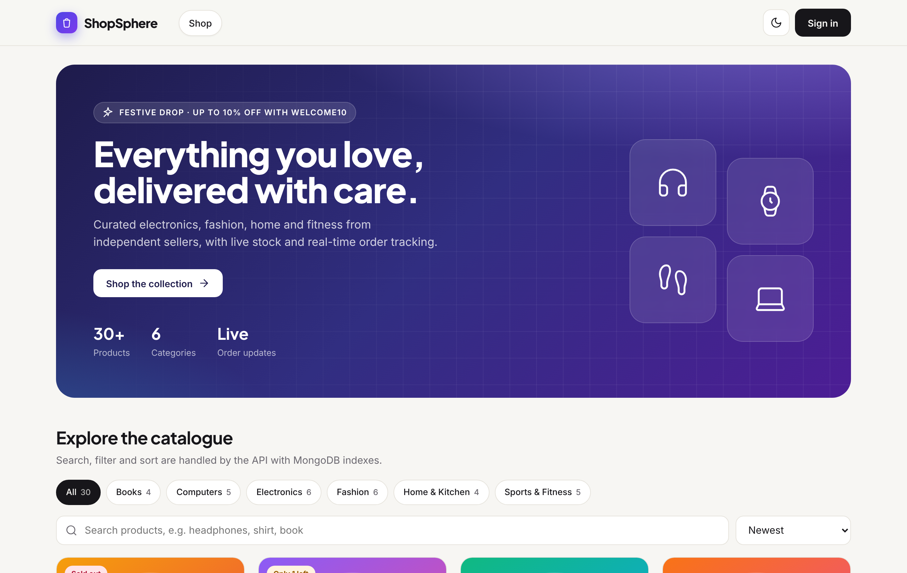

# ShopSphere: E-Commerce and Inventory Management System

Backend Development Capstone, **Project 4: E-Commerce and Inventory Management System**.

ShopSphere is a REST API built with **Node.js, Express.js, MongoDB and Mongoose**. Customers browse products, keep a cart and place orders. Sellers manage their own products and stock. Administrators manage users, categories, coupons and see platform-wide reports. Stock is updated atomically so it can never oversell, and order and low-stock events are pushed in real time over **Socket.IO**.

A small web UI is included for the demonstration, but every feature is available and tested through the API alone (Postman collection included).



## Team

| Name | Roll number | Primary responsibility |
|---|---|---|
| Harsh Dabas | 2501730061 | Authentication & security, checkout, atomic inventory, EventEmitter & Socket.IO |
| Harshit Baghel | 2501730188 | Database design & models, products/categories/cart APIs, aggregation reports & indexes |
| Mayank | 2501730253 | Validation & error-handling middleware, testing (automated + Postman), web UI, documentation |

## Features

| Area | What is implemented |
|---|---|
| Authentication | Register (customer/seller), login, **JWT access token (15 min) + refresh token (7 days)** with rotation and reuse detection, logout, logout from all devices, change password |
| Security | **bcrypt** password hashing, hashed refresh tokens stored server-side, `tokenVersion` revocation, Helmet headers, CORS, rate limiting on auth routes, input validation with Joi, no secrets in Git |
| RBAC | `customer`, `seller`, `admin` roles enforced by `authorize()` middleware and ownership checks in controllers/services |
| Products | CRUD, full-text search (text index), filter by category/seller/price/in-stock, sort, pagination; sellers can only modify their own products |
| Inventory | Atomic stock decrement (`findOneAndUpdate` with `stock >= qty`), all-or-nothing reservation with compensation, stock restored on cancellation, stock-movement audit trail, low-stock alerts |
| Cart | One cart per customer, server-side pricing (client prices ignored), stock checks, free shipping over ₹999 |
| Orders | Checkout from cart with price snapshots, **simulated payment** (card/UPI/COD, clearly flagged `simulated: true`), coupon codes, status machine `pending → confirmed → shipped → delivered`, cancellation rules |
| Reports | 5 aggregation pipelines: sales by day/month, top products, category sales, inventory summary (`$facet`), low-stock list |
| Real-time | `EventEmitter` domain events (`order.placed`, `order.status_changed`, `stock.low`, `stock.changed`) → Socket.IO rooms + persisted notifications |
| Quality | Centralized error handler, consistent JSON responses, request IDs and logging, 56 automated API tests, Postman collection with 85 requests / 118 assertions |

## Tech stack

Node.js 18+, Express 4, MongoDB 6/7, Mongoose 9, jsonwebtoken, bcrypt, Joi, Socket.IO 4, Helmet, express-rate-limit, Morgan. Tests use Node's built-in test runner with Supertest and socket.io-client; Postman/Newman for API testing.

## Getting started

### Prerequisites

- Node.js 18 or newer (`node -v`)
- MongoDB running locally on `mongodb://127.0.0.1:27017` (MongoDB Community Server, or Docker: `docker run -d -p 27017:27017 --name mongo mongo:7`), or a MongoDB Atlas connection string

### Install and run

```bash
git clone https://github.com/itsHarshDabas/shopsphere.git && cd shopsphere
npm install
cp .env.example .env        # then edit secrets if you like
npm run seed                # creates demo users, products and 45 orders
npm run dev                 # or: npm start
```

Open **http://localhost:5000** for the web UI, or call the API at **http://localhost:5000/api**. Health check: `GET /api/health`.

### Environment variables

| Variable | Description | Example |
|---|---|---|
| `PORT` | HTTP port | `5000` |
| `MONGO_URI` | MongoDB connection string | `mongodb://127.0.0.1:27017/shopsphere` |
| `MONGO_URI_TEST` | Separate database used by `npm test` (it is wiped) | `mongodb://127.0.0.1:27017/shopsphere_test` |
| `JWT_ACCESS_SECRET` | Secret for access tokens (**required**) | long random string |
| `JWT_REFRESH_SECRET` | Different secret for refresh tokens (**required**) | long random string |
| `JWT_ACCESS_EXPIRES_IN` | Access-token lifetime | `15m` |
| `JWT_REFRESH_EXPIRES_IN` | Refresh-token lifetime | `7d` |
| `BCRYPT_SALT_ROUNDS` | bcrypt cost factor | `10` |
| `CORS_ORIGIN` | Allowed origin(s) | `*` |

`.env` is listed in `.gitignore` and is never committed; only `.env.example` is.

### Demo accounts (after `npm run seed`)

All passwords are `Password@123`.

| Role | Email | Notes |
|---|---|---|
| Admin | admin@shopsphere.dev | Full access |
| Seller | seller.tech@shopsphere.dev | Store "TechNova" (electronics, computers, books) |
| Seller | seller.style@shopsphere.dev | Store "Urban Loom" (fashion, home, fitness) |
| Customer | aarav@shopsphere.dev | Has items in cart |
| Customer | priya@shopsphere.dev | |
| Customer | kabir@shopsphere.dev | |

Coupons: `WELCOME10` (10% off, min ₹999, max ₹500), `FLAT250` (₹250 off over ₹2000), `EXPIRED5` (expired, for negative tests).

## Scripts

| Command | Purpose |
|---|---|
| `npm run dev` | Start with nodemon (auto-reload) |
| `npm start` | Start in production mode |
| `npm run seed` | Reset the database and load demo data |
| `npm test` | Run the 56 automated API tests (uses `MONGO_URI_TEST`) |
| `npm run test:postman` | Run the Postman collection with Newman (server must be running, seed first) |

## Project structure

```
src/
  config/        env.js (dotenv + validation), db.js (Mongoose connection)
  models/        User, Category, Product, Cart, Order, Coupon, Notification, StockMovement
  validators/    Joi schemas per module
  middleware/    auth (authenticate/authorize), validate, requestLogger, errorHandler
  routes/        one router per resource, mounted in routes/index.js
  controllers/   thin HTTP layer: read request, call service/model, send response
  services/      business logic: auth, cart, order, inventory, coupon, report
  events/        eventBus.js (EventEmitter) and listeners.js
  sockets/       Socket.IO server, JWT handshake auth, rooms
  utils/         ApiError, asyncHandler, response helpers, pagination, tokens
  app.js         Express app and middleware chain
  server.js      HTTP server + Socket.IO bootstrap
scripts/         seed.js, build-postman.js
tests/           API tests (node:test + supertest + socket.io-client)
postman/         Postman collection and environment
public/          demo web UI (vanilla JS SPA)
docs/            API reference, database design, project report, screenshots
```

**Request flow:** `Route → validate (Joi) → authenticate (JWT) → authorize (role) → Controller → Service → Mongoose Model → MongoDB → response helper` with any thrown error caught by `asyncHandler` and rendered by the centralized `errorHandler`.

## Documentation

- [API reference](docs/API.md): every endpoint, auth requirement, body, sample response and errors, plus Socket.IO events
- [Database design](docs/DATABASE.md): collections, schemas, relationships, indexes, aggregation pipelines
- [Project report](docs/Project_Report.docx)
- [Postman collection](postman/ShopSphere.postman_collection.json): import it with the environment file, run `npm run seed`, then run the whole collection

## Response format

```json
// success
{ "success": true, "message": "OK", "data": { ... }, "meta": { "total": 30, "page": 1, "limit": 12, "totalPages": 3 } }
// error
{ "success": false, "message": "Validation failed", "errors": [{ "field": "price", "message": "price must be greater than or equal to 0" }], "requestId": "..." }
```

Status codes used: 200, 201, 400 (validation), 401 (no/invalid token), 402 (simulated payment declined), 403 (role not allowed), 404, 409 (duplicate/conflict/insufficient stock), 422 (business rule), 429 (rate limit), 500.

## Payment notice

No real payment gateway is integrated. All payments are **simulated**: card and UPI payments are approved instantly with a `SIM-…` transaction id, COD is marked paid on delivery, and every order stores `payment.simulated = true`. No card or bank data is collected.
